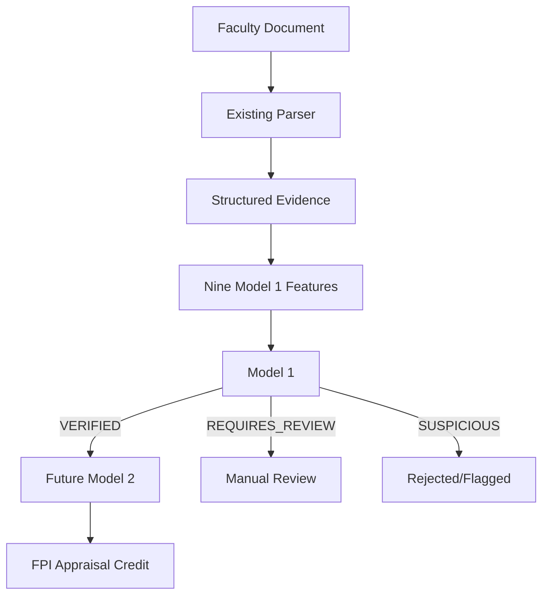

# Model Architecture

The Faculty Performance/Professional Information project utilizes a two-model architecture to evaluate and score faculty evidence. 

## Architecture Flow

## Component Breakdown

### MODEL 1 = Evidence Verification (Prototype Completed)
Model 1 acts as a gatekeeper. It evaluates nine structural features extracted from the faculty document to predict whether the evidence is reliable. 
Model 1 controls whether evidence is eligible to proceed to Model 2. Note: External web verification is not currently implemented; Model 1 relies on the structural presence and fuzzy-matching of extracted entities.

### MODEL 2 = Future Appraisal Scoring Engine (Planned)
Model 2 is NOT implemented yet.
Once built, Model 2 will take `VERIFIED` evidence and assign appropriate FPI appraisal credit based on the quality and impact of the evidence.
